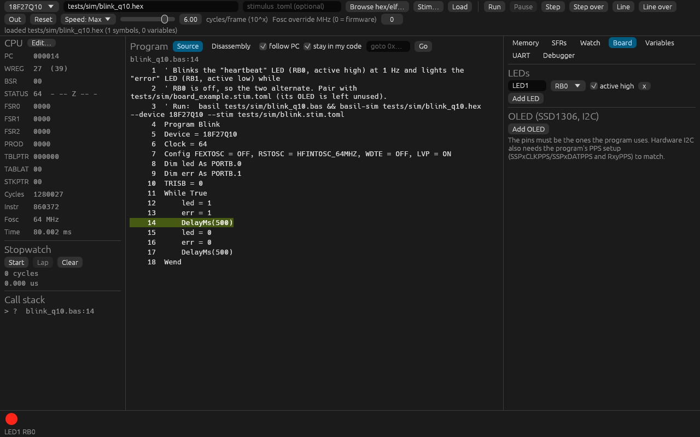
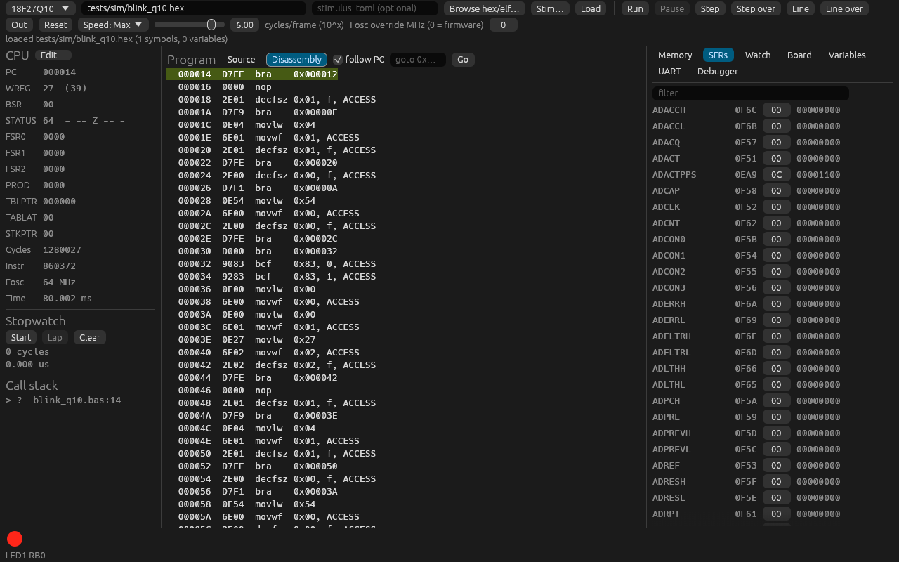

# PicSim — cycle-counting PIC16 / PIC18 simulator

PicSim simulates 8-bit Microchip **PIC16 and PIC18** microcontrollers. It runs the `.hex` file your toolchain produces,
counts instruction cycles, models the on-chip peripherals, and gives you a graphical debugger, a command-line runner for
scripted tests and benchmarks, and editor debugging through the **Debug Adapter Protocol** (VS Code).

It is written in Rust and runs on Linux. Simulated time is independent of host speed: a program that waits one simulated
second can finish in milliseconds, or be paced to real time.

## Programs

| Program | Kind | Use it to |
|---|---|---|
| `pic-sim` | Window (egui) | Load a program, run and step it by instruction or source line, set breakpoints, watch registers, memory and variables, wire LEDs and an OLED display to pins, time code with a stopwatch |
| `basil-sim` | Command line | Run for a number of cycles or until a symbol is reached, then print variables, serial/SPI/I2C traffic, pin changes and the OLED picture; drive scripted tests and benchmarks |
| `basil-sim-dap` | DAP server | Source and instruction breakpoints, stepping, stack frames and typed variables from VS Code (PIC16 and PIC18) |

All three use the same simulated parts and read the same TOML **stimulus** file, which says what the outside world does
to the pins, serial receiver, ADC and so on.

## Screenshots

`pic-sim` running the blink example (`tests/sim/blink_q10.hex`, PIC18F27Q10) with a simulated LED on RB0: BASIC source
with the current line, CPU registers, stopwatch and call stack, and the board strip along the bottom.



The same program in the disassembly view, with the special function register list (address, hex and binary values) beside it.



## Supported devices

64 device descriptions generated from Microchip device packs and cross-checked against the data sheets:

| Family | Parts |
|---|---|
| PIC18-Q10 | 18F27Q10 |
| PIC18-Q41 | 18F04Q41 … 18F16Q41 |
| PIC18-K22 | 18F23K22 … 18F46K22 and the LF variants |
| PIC16F131xx / F132xx | 16F13113 … 16F13145, 16F13214 … 16F13245 |
| PIC16F152xx | 16F15213 … 16F15244 |
| PIC16F171xx | 16F17126, 16F17146 |
| PIC16F180x6 | 16F18056, 16F18076 |
| PIC16F183xx | 16F18313 … 16F18346 and the LF variants |

Modelled peripherals include timers, interrupts (priority and vectored), UART/EUSART, SPI/I2C (MSSP), ADC/ADCC, CCP and
PWM, CWG, CLC, comparators, DMA, CRC and scanner, watchdog, NVM/EEPROM, interrupt-on-change and PPS. A register whose
peripheral has no model behaves as plain storage, and both programs report which such registers a program touched.
The full list, with data-sheet citations and assumptions, is in [`docs/FACTS-SIM.md`](docs/FACTS-SIM.md).

## Build and install

```sh
cargo build --release --workspace
python3 scripts/install-local.py            # binaries, devices and manual under ~/.local (or pass --prefix)
```

Keep the `devices/` folder beside the binaries when running them in place. Release archives, the manual and the VS Code
extension are produced by `python3 scripts/package-release.py` (see [`docs/RELEASE-0.2.12.md`](docs/RELEASE-0.2.12.md)).

## Quick start

```sh
target/release/basil-sim prog.hex --device 18F27Q10 --until done --dump result:2
target/release/pic-sim                      # graphical debugger
```

Useful `basil-sim` options: `--max-cycles`, `--stim FILE`, `--bp SYMBOL`, `--trace FROM-TO`, `--fosc MHZ`, `--speed`.
Run `basil-sim --help` for all of them. For VS Code debugging, install the VSIX and set `basilSim.adapterPath` to
`basil-sim-dap` ([`docs/DAP.md`](docs/DAP.md)).

## Accuracy

The simulator counts cycles from the instruction set and peripheral rules in the data sheets, and is compared against
MPLAB X's MDB simulator on a suite of compiled test programs (`scripts/gpr_snapshot.py` compares every general-purpose RAM
byte and the cycle count). Known differences, and which engine each one follows, are recorded in
[`docs/FACTS-SIM.md`](docs/FACTS-SIM.md) and [`docs/MDB-DIFFERENTIAL-2026-11-18.md`](docs/MDB-DIFFERENTIAL-2026-11-18.md).
Not all peripheral timing has been measured on silicon, and analogue behaviour is not simulated.

## Documentation

* [`docs/MANUAL.md`](docs/MANUAL.md) / [`docs/PicSim_Manual.pdf`](docs/PicSim_Manual.pdf) — user manual
* [`docs/FACTS-SIM.md`](docs/FACTS-SIM.md) — modelled behaviour, assumptions and MDB differences
* [`docs/DEVICE-FORMAT.md`](docs/DEVICE-FORMAT.md) — device description format
* [`docs/DAP.md`](docs/DAP.md) — editor debugging

## Layout

```
crates/picsim      simulation library (PIC16 and PIC18 cores, peripherals)
crates/devdesc     device description reader
tools/picsim       basil-sim and basil-sim-dap
tools/picsim-gui   pic-sim
tools/vscode-picsim  VS Code debug extension
devices/           device descriptions
tests/probe/       assembly probes compared against MDB
scripts/           regression, MDB differential and packaging tools
```

## License

MIT, see [`LICENSE`](LICENSE).
